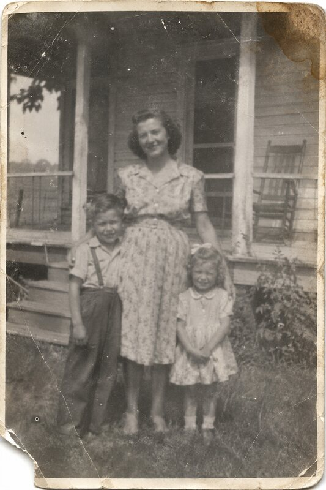
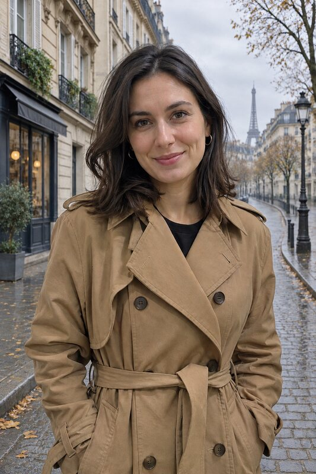
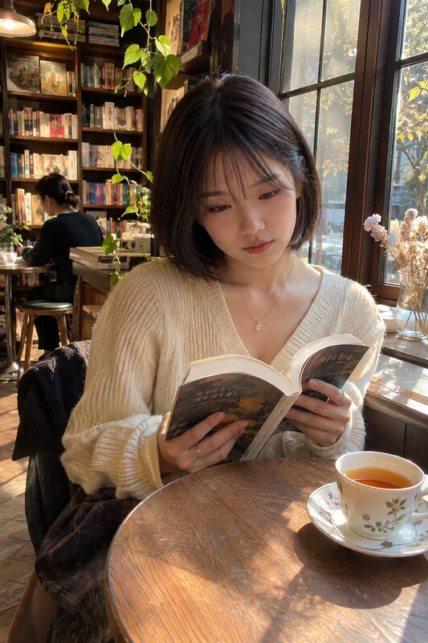
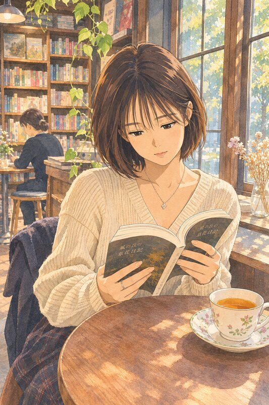
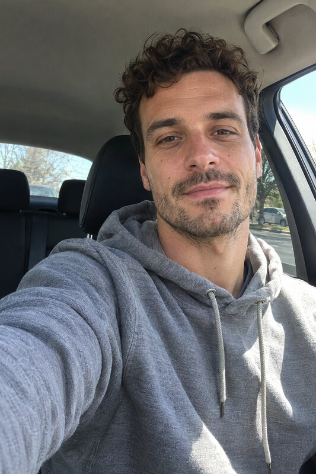
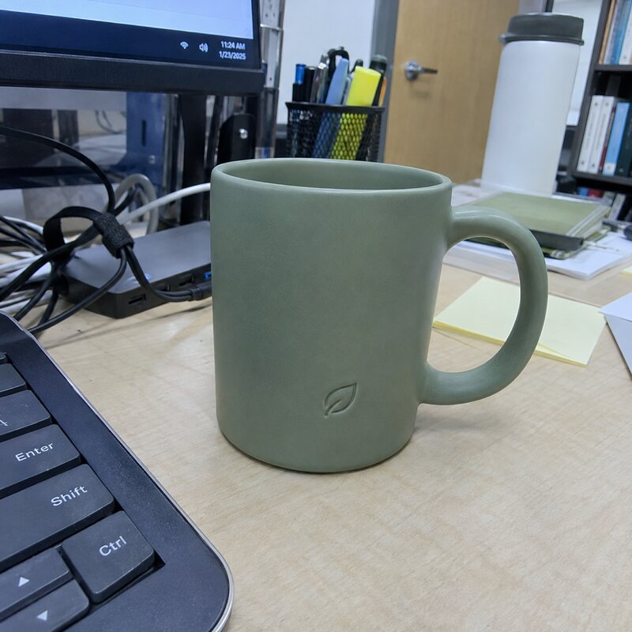
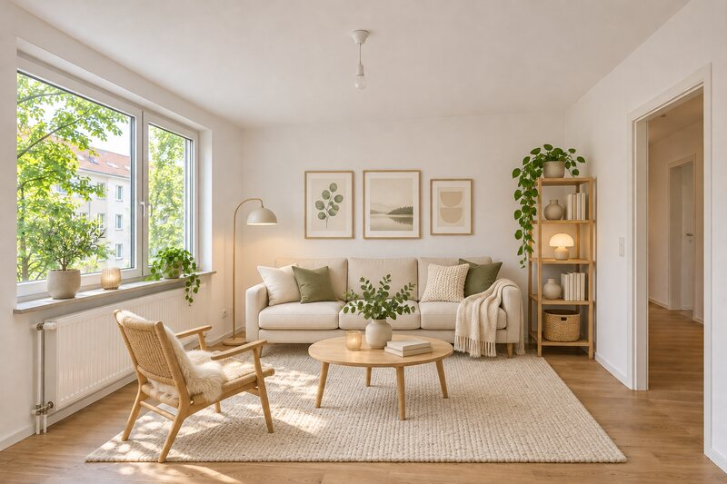

# Awesome Image-to-Image Prompts

[](https://pictcraft.com/)

<table>
  <tr>
    <td width="110" align="center">
      <a href="https://pictcraft.com/"></a>
    </td>
    <td>
      <b>Sponsored by <a href="https://pictcraft.com/">Image to Image AI</a></b><br>
      Upload a photo, paste any prompt from this list and get the edit. GPT Image, Nano Banana, Seedream and more in one place, free to try after sign-up.<br>
      <b><a href="https://pictcraft.com/">Try Image to Image AI &rarr;</a></b>
    </td>
  </tr>
</table>

A collection of <!-- TOTAL -->720<!-- /TOTAL --> copy-ready **image to image AI prompts** and text-to-image prompts, organized by task: restore an old photo, change the background, swap an outfit, make a headshot, stage a room, shoot a product, swap gender, turn a photo into a figurine. Every prompt is plain English and works with instruction-based image editors such as GPT Image, Nano Banana, Seedream and FLUX Kontext.

All prompts are in plain files you can clone, search and reuse: one Markdown file per category, plus `prompts.json` and `prompts.csv` with everything in one place.

## Contents

- [Quick start](#quick-start)
- [See the results](#see-the-results)
- [All categories](#all-categories)
- [How to write an image-to-image prompt](#how-to-write-an-image-to-image-prompt)
- [Trends and where they started](#trends-and-where-they-started)
- [Sponsor](#sponsor)
- [Contributing](#contributing)
- [License](#license)

## Quick start

```bash
git clone https://github.com/vicmini/awesome-image-to-image-prompts.git
cd awesome-image-to-image-prompts
```

```text
prompts/
  image-to-image/   edit prompts for an uploaded photo, one file per task
  text-to-image/    prompts that start from nothing
prompts.json        every prompt with id, category, title, tags
prompts.csv         the same, for spreadsheets
```

Use them in code:

```python
import json

prompts = json.load(open("prompts.json"))
restore = [p for p in prompts if p["category"] == "restore-colorize"]
print(restore[0]["prompt"])
```

Or skip setup: paste any prompt into [Image to Image AI](https://pictcraft.com/), upload your photo and run it.

## See the results

A few prompts from the collection, run on real-looking test photos. The rest are in the [category files](#all-categories).

### Restore and colorize an old photo

| Before | After |
|---|---|
|  |  |

```text
Restore this old photo: remove scratches, dust and stains, repair the torn corner, and sharpen faces gently. Then add natural, period-correct color. Keep every person's face and expression exactly as they are.
```

More: [prompts/image-to-image/restore-colorize.md](prompts/image-to-image/restore-colorize.md)

### Change the background

| Before | After |
|---|---|
|  |  |

```text
Replace the background with a quiet Paris street on an overcast morning. Match the light on the person to the soft, cool daylight. Keep the person unchanged.
```

More: [prompts/image-to-image/background.md](prompts/image-to-image/background.md)

### Photo to anime

| Before | After |
|---|---|
|  |  |

```text
Redraw this photo as a hand-painted anime film still: soft watercolor backgrounds, gentle light, clean line art. Keep the composition and the person recognizable.
```

More: [prompts/image-to-image/style-transfer.md](prompts/image-to-image/style-transfer.md)

### Selfie to professional headshot

| Before | After |
|---|---|
|  |  |

```text
Turn this selfie into a professional LinkedIn headshot: navy blazer over a white shirt, plain soft grey background, soft front light, head and shoulders, looking at the camera. Keep the face exactly the same.
```

More: [prompts/image-to-image/headshot-portrait.md](prompts/image-to-image/headshot-portrait.md)

### Desk photo to product shot

| Before | After |
|---|---|
|  |  |

```text
Put this product on a slab of black stone with a warm rim light and a dark background, like a luxury ad. Keep the product shape, label and colors exactly.
```

More: [prompts/image-to-image/product-photo.md](prompts/image-to-image/product-photo.md)

### Stage an empty room

| Before | After |
|---|---|
|  |  |

```text
Furnish this empty room as a Scandinavian living room: light oak, a cream sofa, a wool rug and plants. Keep the walls, window and floor exactly.
```

More: [prompts/image-to-image/interior-real-estate.md](prompts/image-to-image/interior-real-estate.md)

### Sketch to product render

| Before | After |
|---|---|
|  |  |

```text
Turn this sketch into a studio product photo: matte black with brushed metal hinges, soft shadow, light grey background. Keep the shape from the sketch.
```

More: [prompts/image-to-image/sketch-to-render.md](prompts/image-to-image/sketch-to-render.md)

For gender swap results, see the [gender swap AI examples on PictCraft](https://pictcraft.com/gender-swap). For text inside images, see the [Seedream 5.5 examples](https://pictcraft.com/seedream-5-5).

## All categories

<!-- CATEGORIES:START -->
**Image-to-image** (480)

| Category | Prompts |
|---|---|
| [Age and gender](prompts/image-to-image/age-gender.md) | 30 |
| [Change the background](prompts/image-to-image/background.md) | 30 |
| [Combine several images](prompts/image-to-image/combine-images.md) | 30 |
| [Figurines, toys and stickers](prompts/image-to-image/figurine-toy-sticker.md) | 30 |
| [Hair, makeup and look](prompts/image-to-image/hair-makeup.md) | 30 |
| [Headshots and portraits](prompts/image-to-image/headshot-portrait.md) | 30 |
| [Interior design and real estate](prompts/image-to-image/interior-real-estate.md) | 30 |
| [Change lighting, weather and season](prompts/image-to-image/light-weather-season.md) | 30 |
| [Outfit swap and virtual try-on](prompts/image-to-image/outfit-try-on.md) | 30 |
| [Pets](prompts/image-to-image/pets.md) | 30 |
| [Product photos](prompts/image-to-image/product-photo.md) | 30 |
| [Remove, add and expand](prompts/image-to-image/remove-add-expand.md) | 30 |
| [Restore and colorize old photos](prompts/image-to-image/restore-colorize.md) | 30 |
| [Sketch to render](prompts/image-to-image/sketch-to-render.md) | 30 |
| [Social media trends](prompts/image-to-image/social-trends.md) | 30 |
| [Style transfer](prompts/image-to-image/style-transfer.md) | 30 |

**Text-to-image** (240)

| Category | Prompts |
|---|---|
| [Architecture and interiors](prompts/text-to-image/architecture-interiors.md) | 30 |
| [Food and drink](prompts/text-to-image/food-drink.md) | 30 |
| [Illustration and character design](prompts/text-to-image/illustration-characters.md) | 30 |
| [Infographics and diagrams](prompts/text-to-image/infographics-diagrams.md) | 30 |
| [Logos and icons](prompts/text-to-image/logos-icons.md) | 30 |
| [Portraits and people](prompts/text-to-image/portraits-people.md) | 30 |
| [Posters and typography](prompts/text-to-image/posters-typography.md) | 30 |
| [Product shots and ads](prompts/text-to-image/product-ads.md) | 30 |
<!-- CATEGORIES:END -->

## How to write an image-to-image prompt

An image-to-image prompt is an edit instruction, not a scene description. The model already has your photo, so tell it what to change and what to leave alone.

1. **Say the change in one sentence.** "Change her hair to copper red" works better than a paragraph about hair.
2. **Name what must stay.** End with a keep clause: *Keep the face, pose and lighting unchanged.* This is the single biggest fix for edits that drift.
3. **Describe the light.** Most fake-looking edits come from light that does not match. "Soft window light from the left" or "golden hour from behind" ties the new part to the old one.
4. **One edit per run.** For three changes, run three times and feed each result into the next.
5. **For more than one image, say which is which.** "The woman from the first image, the jacket from the second image."

Reusable keep clauses:

```text
Keep the person's face, expression and pose exactly the same.
Keep the composition, camera angle and framing unchanged.
Keep the product shape, label and colors exactly as they are.
Keep the walls, windows and floor; change only the furniture.
```

## Trends and where they started

These ideas went viral elsewhere. The prompts in this repo are rewritten; follow the links for the original posts.

| Trend | What it is | Original post / coverage |
|---|---|---|
| Figurine | A person turned into a boxed collectible figure on a desk | [@ZHO_ZHO_ZHO](https://x.com/ZHO_ZHO_ZHO/status/1958539464994959715) |
| Ghibli-style photos | Photos redrawn as hand-painted animation | Credited to [@GrantSlatton](https://knowyourmeme.com/memes/studio-ghibli-ai-generator) (March 2025) |
| Action figure box | Yourself as a toy in a blister pack | [AI News coverage](https://www.artificialintelligence-news.com/news/chatgpt-got-another-viral-moment-with-ai-action-figure-trend/) |
| Outfit swap | Put clothes from one photo on a person in another | [@skirano](https://x.com/skirano/status/1960343968320737397) |
| Hairstyle grid | One face, many haircuts | [@balconychy](https://x.com/balconychy/status/1960665038504779923) |
| Old photo colorize | Restore and add color | [@GeminiApp](https://x.com/GeminiApp/status/1960347483021959197) |
| Professional headshot | Selfie to studio headshot | [@PavolRusnak](https://x.com/PavolRusnak/status/1994097306526994558) |
| Aging through the years | The same person across decades | [@dr_cintas](https://x.com/dr_cintas/status/1991888364099035581) |
| Character stickers | A person or pet as a sticker set | [@op7418](https://x.com/op7418/status/1960385812132192509) |
| Instant photo | Edits framed as an instant-camera print | [@cheese_ai07](https://x.com/cheese_ai07/status/1994662338608161086) |
| Hug my younger self | You and your childhood photo together | [Free Press Journal coverage](https://www.freepressjournal.in/lifestyle/how-to-create-hug-my-younger-self-ai-generated-image-know-prompts) |
| Gender swap | "What would I look like as a man / woman" | [PictCraft gender swap examples](https://pictcraft.com/gender-swap) |

## Sponsor

<table>
  <tr>
    <td width="110" align="center">
      <a href="https://pictcraft.com/"></a>
    </td>
    <td>
      <b>Sponsored by <a href="https://pictcraft.com/">Image to Image AI</a></b><br>
      Upload a photo, paste any prompt from this list and get the edit. GPT Image, Nano Banana, Seedream and more in one place, free to try after sign-up.<br>
      <b><a href="https://pictcraft.com/">Try Image to Image AI &rarr;</a></b>
    </td>
  </tr>
</table>

This collection is sponsored by [Image to Image AI](https://pictcraft.com/) (PictCraft). The example images in this repo were made with it.

## Contributing

Pull requests are welcome.

1. Add your prompt to the right file in `prompts/`, following the format already there (a numbered `##` title, a `Tags:` line and a `text` code block).
2. Write the prompt yourself, or credit the original author with a link.
3. Run `python3 scripts/build.py` to refresh `prompts.json`, `prompts.csv` and the category table.

## License

The prompts, text and example images in this repository are licensed under [CC BY 4.0](https://creativecommons.org/licenses/by/4.0/). Linked posts belong to their authors.
