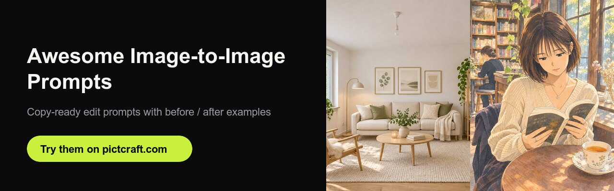
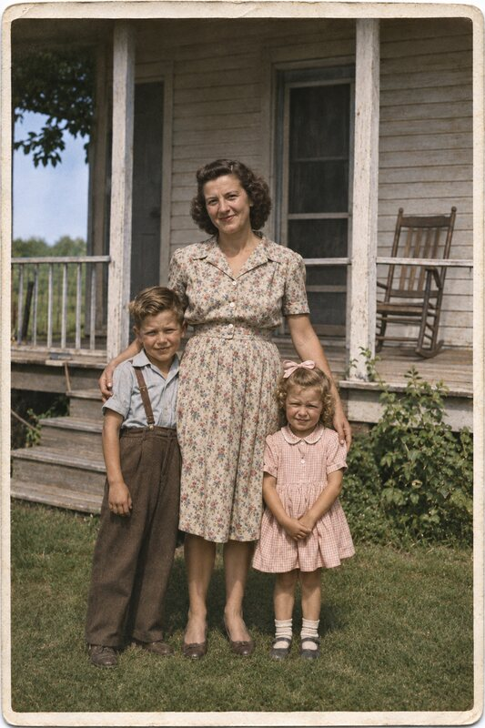
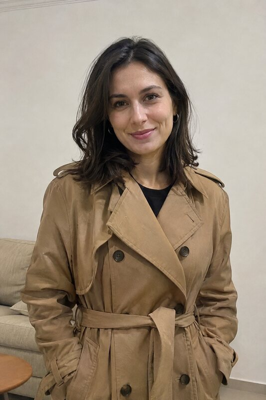
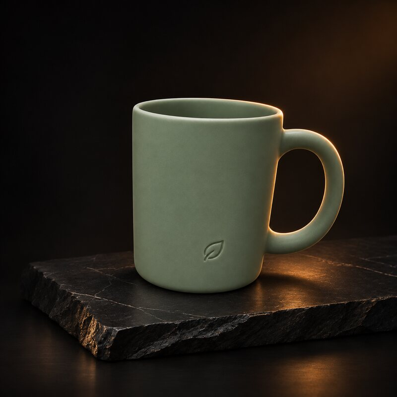
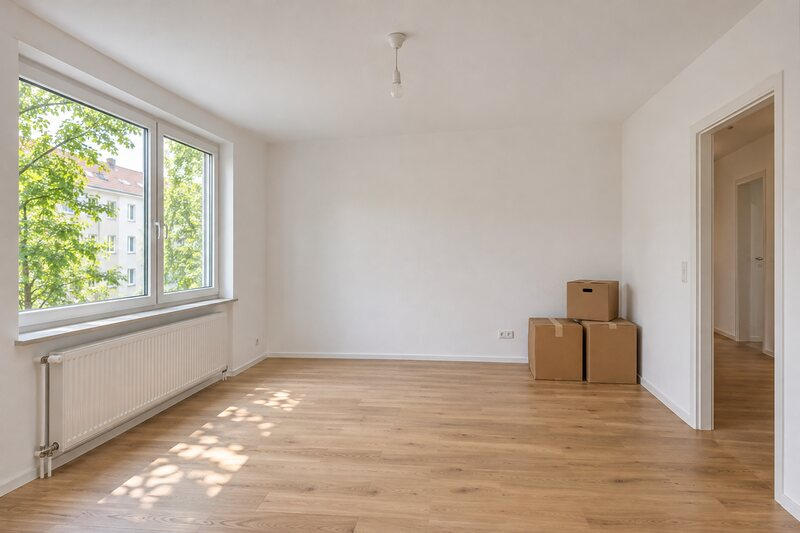
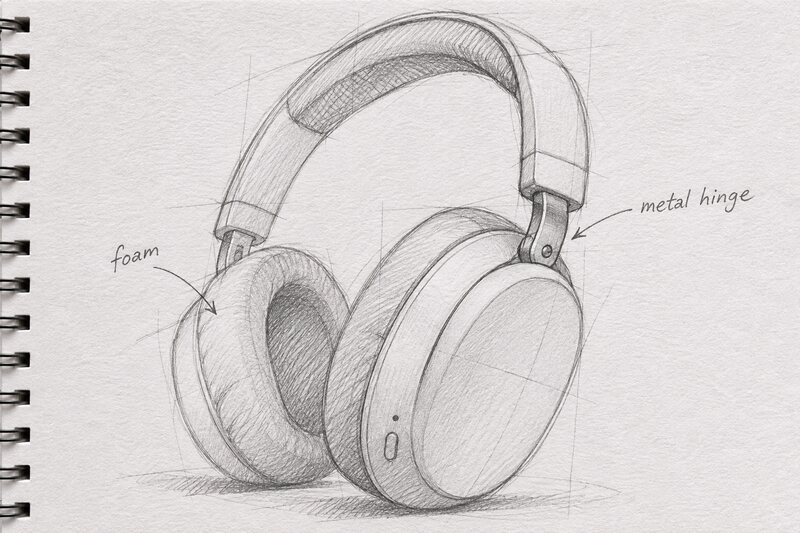
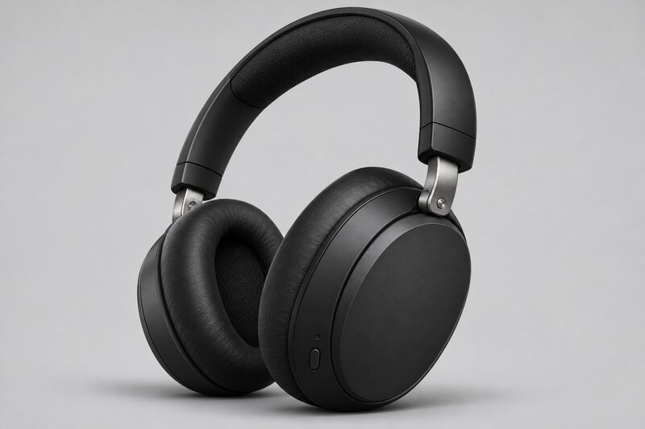

# Awesome Image-to-Image Prompts

[](https://pictcraft.com/?utm_source=github&utm_medium=readme&utm_campaign=awesome-image-to-image-prompts)

Copy-ready **image to image AI prompts**, organized by editing task: restore an old photo, change the background, swap an outfit, make a headshot, stage a room, shoot a product, swap gender, turn a photo into a figurine. Each prompt is written as a plain instruction that works with instruction-based image editors such as GPT Image, Nano Banana, Seedream and FLUX Kontext. A smaller [text-to-image section](#text-to-image-prompts) covers posters, infographics and product shots.

Every prompt in this list was written for this repo. Where an idea comes from a viral trend, the [Trends](#trends-and-where-they-started) table credits the original post.

> Want to try a prompt without setting anything up? Paste it into [PictCraft, an image to image AI editor](https://pictcraft.com/?utm_source=github&utm_medium=readme&utm_campaign=awesome-image-to-image-prompts), upload your photo and run it.

## Contents

- [How to write an image-to-image prompt](#how-to-write-an-image-to-image-prompt)
- Image-to-image prompts
  - [Restore and colorize old photos](#restore-and-colorize-old-photos)
  - [Change the background](#change-the-background)
  - [Hair, makeup and look](#hair-makeup-and-look)
  - [Outfit swap and virtual try-on](#outfit-swap-and-virtual-try-on)
  - [Style transfer](#style-transfer)
  - [Headshots and portraits](#headshots-and-portraits)
  - [Product photos](#product-photos)
  - [Interior design and real estate](#interior-design-and-real-estate)
  - [Remove, add and expand](#remove-add-and-expand)
  - [Age and gender](#age-and-gender)
  - [Figurines, toys and stickers](#figurines-toys-and-stickers)
  - [Pets](#pets)
  - [Sketch to render](#sketch-to-render)
  - [Combine several images](#combine-several-images)
- [Text-to-image prompts](#text-to-image-prompts)
- [Trends and where they started](#trends-and-where-they-started)
- [Contributing](#contributing)
- [License](#license)

---

## How to write an image-to-image prompt

An image-to-image prompt is an edit instruction, not a scene description. The model already has your photo, so tell it what to change and what to leave alone.

1. **Say the change in one sentence.** "Change her hair to copper red" works better than a paragraph about hair.
2. **Name what must stay.** End with a keep clause: *Keep the face, pose and lighting unchanged.* This is the single biggest fix for edits that drift.
3. **Describe the light.** Most fake-looking edits come from light that does not match. "Soft window light from the left" or "golden hour from behind" ties the new part to the old one.
4. **One edit per run.** For three changes, run three times and feed each result into the next.
5. **For more than one image, say which is which.** "The woman from the first image, the jacket from the second image."

Reusable keep clauses:

```text
Keep the person's face, expression and pose exactly the same.
Keep the composition, camera angle and framing unchanged.
Keep the product shape, label and colors exactly as they are.
Keep the walls, windows and floor; change only the furniture.
```

---

## Image-to-image prompts

### Restore and colorize old photos

| Before | After |
|---|---|
|  |  |

```text
Restore this old photo: remove scratches, dust and stains, repair the torn corner, and sharpen faces gently. Then add natural, period-correct color. Keep every person's face and expression exactly as they are.
```

```text
Colorize this black and white photo with realistic, slightly faded 1960s color film tones. Keep the grain light and do not change any faces.
```

```text
This photo is blurry and low resolution. Make it sharp and clear as if taken on a modern camera, without changing the people, their clothes or the background.
```

```text
Repair the water damage on the left side of this photo and rebuild the missing part of the background so it matches the rest.
```

### Change the background

| Before | After |
|---|---|
|  |  |

```text
Replace the background with a quiet Paris street on an overcast morning. Match the light on the person to the soft, cool daylight. Keep the person unchanged.
```

```text
Put this person on a beach at golden hour, with the sun low behind them and warm rim light on their hair. Keep the face, pose and clothes unchanged.
```

```text
Replace the background with a plain light grey studio wall and soft, even light. Keep the person and their shadow natural.
```

```text
Move this scene to a snowy mountain village at dusk, with warm lights in the windows. Add a little snow on the shoulders. Keep the face and jacket the same.
```

### Hair, makeup and look

```text
Change her hair to a shoulder-length copper red bob with soft waves. Keep her face, makeup and pose.
```

```text
Show this person with six different hairstyles in a 3x2 grid: buzz cut, long curly, slick back, bob, braids and messy bun. Same face and lighting in every tile, each labeled.
```

```text
Give him a short, well-kept beard and a tidy undercut. Keep everything else the same.
```

```text
Add soft natural makeup: light foundation, peach blush and a nude lip. Keep skin texture visible; do not smooth it.
```

### Outfit swap and virtual try-on

```text
Dress the person from the first image in the jacket from the second image. Keep the jacket's color, fabric and logo exactly, and fit it naturally to their pose. Keep the face and background.
```

```text
Change the outfit to a navy wool suit with a white shirt and no tie. Keep the face, pose and background unchanged.
```

```text
Show this model wearing the dress from the second image in a clean e-commerce studio shot, full body, white background, front view.
```

### Style transfer

| Before | After |
|---|---|
|  |  |

```text
Redraw this photo as a hand-painted anime film still: soft watercolor backgrounds, gentle light, clean line art. Keep the composition and the person recognizable.
```

```text
Restyle this as a warm 35mm film photo with soft grain, slight light leaks and faded blacks.
```

```text
Make this look like it was taken on a 2000s point-and-shoot camera at night: hard direct flash, slight red-eye, a date stamp in the corner.
```

```text
Turn this photo into a watercolor painting on textured paper, with loose edges and visible brush strokes.
```

```text
Rebuild this scene as a claymation set: everything made of soft modeling clay, with fingerprints visible on the surfaces.
```

```text
Turn this into 16-bit pixel art with a limited palette, as a game screenshot.
```

```text
Redraw this as a 1990s American comic book panel with halftone dots, bold ink and a speech bubble that says "Not again."
```

### Headshots and portraits

| Before | After |
|---|---|
|  |  |

```text
Turn this selfie into a professional LinkedIn headshot: navy blazer over a white shirt, plain soft grey background, soft front light, head and shoulders, looking at the camera. Keep the face exactly the same.
```

```text
Make this a moody studio portrait: black turtleneck, charcoal background, one warm light from the left. Keep the face and expression.
```

```text
Make this a 1970s yearbook photo: feathered hair, a wide-collar shirt, a mottled blue backdrop and faded color.
```

```text
Turn this into a black and white editorial portrait with high contrast and deep shadows, like a magazine cover. Keep the face natural, with real skin texture.
```

### Product photos

| Before | After |
|---|---|
|  |  |

```text
Put this product on a slab of black stone with a warm rim light and a dark background, like a luxury ad. Keep the product shape, label and colors exactly.
```

```text
Make a clean Amazon-style main image: pure white background, soft shadow under the product, product centered and filling 85% of the frame.
```

```text
Place this skincare bottle on a wet rock by a small waterfall, with ferns and soft morning mist. Keep the bottle and its label unchanged.
```

```text
Show this sneaker floating at an angle above a pastel blue background, with a soft shadow below and small water splashes around it.
```

```text
Turn this product into a miniature diorama: the product as a giant building in a tiny city, with little people walking around it.
```

### Interior design and real estate

| Before | After |
|---|---|
|  |  |

```text
Furnish this empty room as a Scandinavian living room: light oak, a cream sofa, a wool rug and plants. Keep the walls, window and floor exactly.
```

```text
Redesign this kitchen in a modern farmhouse style with white cabinets, a wood island and brass handles. Keep the layout and window positions.
```

```text
Show this bedroom at night with warm lamps on and city lights outside the window. Keep the furniture.
```

```text
Turn this floor plan into a top-down 3D render of the furnished apartment, with soft daylight and realistic materials.
```

### Remove, add and expand

```text
Remove the people in the background. Fill the space with what would naturally be behind them. Keep the main subject unchanged.
```

```text
Remove the power lines and the trash can from this photo.
```

```text
Add a golden retriever sitting next to him on the bench, lit by the same afternoon light.
```

```text
Expand this photo to a wide 16:9 frame, continuing the landscape on both sides naturally.
```

### Age and gender

See it live: [gender swap AI examples](https://pictcraft.com/gender-swap?utm_source=github&utm_medium=readme&utm_campaign=awesome-image-to-image-prompts).

```text
Show this person as the opposite gender, like a sibling: change the jaw, brow, nose and face shape, not just the hair and clothes. Keep the eye color, skin tone, pose and background.
```

```text
Male to female: give her long wavy hair, soft natural makeup and a fitted version of the same outfit. Change the facial structure so it reads as a woman, not a man in a wig.
```

```text
Show this person at 70 years old: grey hair, natural wrinkles, slightly fuller face. Keep the expression and setting.
```

```text
Show this person as a 7-year-old child in the same pose and outfit style, as a school photo.
```

### Figurines, toys and stickers

```text
Turn this person into a 1/7 scale collectible figure standing on a round clear base on a desk. Behind it, put the figure's printed box with their name, and a monitor showing the 3D model.
```

```text
Make this person an action figure in a plastic blister pack. Name on top: "WEEKEND HIKER". Accessories in the pack: boots, a map and a coffee flask.
```

```text
Turn this pet into a set of six die-cut stickers with white borders, each a different expression: happy, sleepy, angry, surprised, love and hungry.
```

```text
Make a chibi 3D blind-box figure of this person: big head, small body, soft vinyl look, on a pastel background.
```

### Pets

```text
Show this dog as a human with the same coloring and personality: a man in his twenties with sandy hair and a brown jacket, standing in the same park.
```

```text
Make a royal oil portrait of this cat in a velvet robe and gold crown, in a heavy gilt frame.
```

```text
Put this cat in a tiny astronaut suit floating inside a space station. Keep its face and markings exactly.
```

### Sketch to render

| Before | After |
|---|---|
|  |  |

```text
Turn this sketch into a studio product photo: matte black with brushed metal hinges, soft shadow, light grey background. Keep the shape from the sketch.
```

```text
Turn this rough floor sketch into a clean architectural drawing with labeled rooms and measurements.
```

```text
Color this line drawing as a finished children's book illustration with soft gouache textures.
```

### Combine several images

```text
Put the woman from the first image and the man from the second image together in one photo at a cafe table, both laughing, lit by the same window light.
```

```text
Place the product from the first image in the room from the second image, on the side table, at a believable size and with a matching shadow.
```

```text
Hug my younger self: put the adult from the first image and the child from the second image together in one instant-camera photo, both smiling, with soft flash.
```

---

## Text-to-image prompts

These start from nothing. Text inside images (posters, menus, infographics) works best with newer models such as GPT Image 2 and [Seedream 5.5](https://pictcraft.com/seedream-5-5?utm_source=github&utm_medium=readme&utm_campaign=awesome-image-to-image-prompts).

```text
A jazz night poster on navy paper with gold letters reading "BLUE HOUR" and "Friday 9 PM, Harbor Club", a saxophone player under a crescent moon, risograph texture.
```

```text
A four-step pour-over coffee infographic in flat illustration style, steps labeled Grind, Bloom, Pour and Serve, with a small icon and one short line under each.
```

```text
A bakery chalkboard menu reading TODAY, Croissant $3, Sourdough $6, Cinnamon Roll $4, hand-lettered in white chalk above a shelf of fresh bread.
```

```text
A square glass perfume bottle with a brushed gold cap on folded cream silk, soft reflections, fine fabric texture, studio light.
```

```text
A close portrait of a fisherman in his sixties by a boathouse window, natural skin texture, grey stubble, soft side light, shot on 85mm.
```

```text
A flat vector app icon of a paper plane inside a rounded square, lime green on near-black, no text.
```

---

## Trends and where they started

These ideas went viral elsewhere. The prompts above are rewritten; follow the links for the original posts.

| Trend | What it is | Original post / coverage |
|---|---|---|
| Figurine | A person turned into a boxed collectible figure on a desk | [@ZHO_ZHO_ZHO](https://x.com/ZHO_ZHO_ZHO/status/1958539464994959715) |
| Ghibli-style photos | Photos redrawn as hand-painted animation | Credited to [@GrantSlatton](https://knowyourmeme.com/memes/studio-ghibli-ai-generator) (March 2025) |
| Action figure box | Yourself as a toy in a blister pack | [AI News coverage](https://www.artificialintelligence-news.com/news/chatgpt-got-another-viral-moment-with-ai-action-figure-trend/) |
| Outfit swap | Put clothes from one photo on a person in another | [@skirano](https://x.com/skirano/status/1960343968320737397) |
| Hairstyle grid | One face, many haircuts | [@balconychy](https://x.com/balconychy/status/1960665038504779923) |
| Old photo colorize | Restore and add color | [@GeminiApp](https://x.com/GeminiApp/status/1960347483021959197) |
| Professional headshot | Selfie to studio headshot | [@PavolRusnak](https://x.com/PavolRusnak/status/1994097306526994558) |
| Aging through the years | The same person across decades | [@dr_cintas](https://x.com/dr_cintas/status/1991888364099035581) |
| Character stickers | A person or pet as a sticker set | [@op7418](https://x.com/op7418/status/1960385812132192509) |
| Instant photo | Edits framed as an instant-camera print | [@cheese_ai07](https://x.com/cheese_ai07/status/1994662338608161086) |
| Hug my younger self | You and your childhood photo together | [Free Press Journal coverage](https://www.freepressjournal.in/lifestyle/how-to-create-hug-my-younger-self-ai-generated-image-know-prompts) |
| Gender swap | "What would I look like as a man / woman" | [PictCraft gender swap examples](https://pictcraft.com/gender-swap?utm_source=github&utm_medium=readme&utm_campaign=awesome-image-to-image-prompts) |

## Contributing

Pull requests are welcome. Please:

- write the prompt yourself, or credit the original author with a link;
- add it under the right task heading, as a `text` code block;
- add before/after images only if you made them and are fine sharing them under the license below.

## License

The prompts and text in this repository are licensed under [CC BY 4.0](https://creativecommons.org/licenses/by/4.0/). Example images were made by PictCraft and are under the same license. Linked posts belong to their authors.
